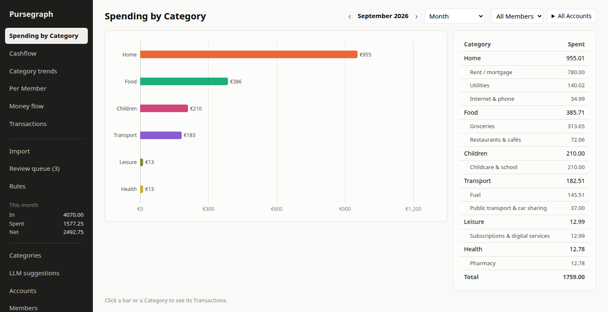
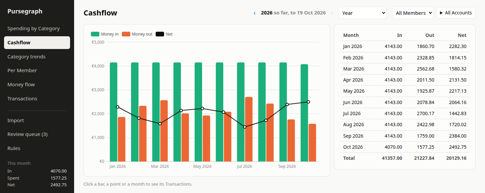
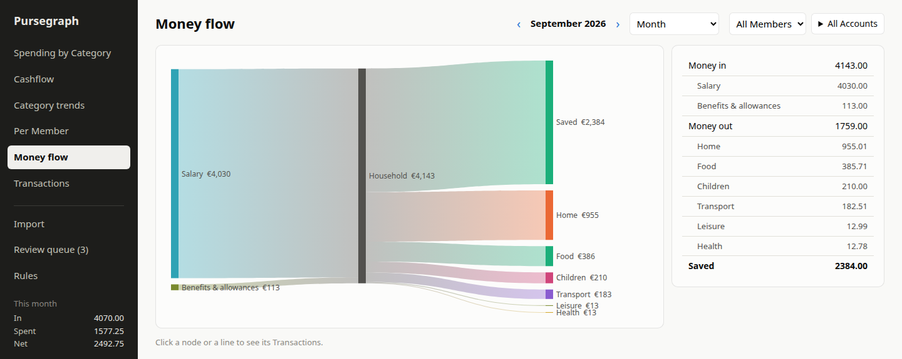

# Pursegraph

A self-hosted family finance overview. Household Members import their bank Statements, every Transaction is categorized, and the whole Household's money flow is shown together. The vocabulary is defined in [`CONTEXT.md`](CONTEXT.md).

Pursegraph is meant to be reached only on the LAN or over a VPN. Never expose it to the internet.



| Cashflow | Money flow |
| --- | --- |
|  |  |

The screenshots show a synthetic Household.

- **Statement import:** parsers for Sparkasse SI, N26 and Revolut PDFs and Revolut CSV exports. Every Statement is balance-checked and de-duplicated against what was already imported.
- **Categorization:** ordered Rules, Transfer detection by IBAN and pairing, then a local LLM (Ollama) for the rest. Low-confidence suggestions wait in a Review queue.
- **Dashboard:** spending by Category, cashflow, Category trends, per-Member and money-flow views, with drill-down to the Transactions and warnings for gaps in the imported periods.

Built with Django 5.2, PostgreSQL, HTMX and ECharts, and deployed with Docker Compose. Tested with pytest against a real PostgreSQL, and checked with ruff and mypy.

## Quick start

```sh
cp .env.example .env    # then set DJANGO_SECRET_KEY, DJANGO_ALLOWED_HOSTS and POSTGRES_PASSWORD
mkdir -p data/statement-files data/backups
docker compose up -d --build
docker compose exec web python manage.py create_admin <username>
```

Then open `http://<host>:8000/` and log in. [Operations](docs/operations.md) covers the full setup, backups and restores, re-parsing Statements, and recovering a locked-out admin. The [user guide](docs/user-guide.md) describes how importing, categorization and Rules behave.

## Development

Dependencies are managed with [uv](https://docs.astral.sh/uv/).

```sh
uv sync
docker compose -f compose.test.yaml up -d   # throwaway PostgreSQL on 127.0.0.1:5433
uv run pytest
uv run ruff check && uv run ruff format --check   # lint + formatting
uv run mypy .                                     # type check (django-stubs knows models' reverse relations)
```

The tests run against a real PostgreSQL database, never SQLite. Parser tests use anonymized extracted-text fixtures in `tests/fixtures/`; `PURSEGRAPH_SAMPLES=1 uv run pytest tests/test_samples.py` also runs the parsers against the real Statements in the gitignored `samples/` directory.

HTMX and ECharts are vendored under `static/vendor/` so the app works without internet access. To upgrade HTMX, replace its file there. ECharts is a custom build of only the charts the Dashboard draws; `static/vendor/echarts.md` has its recipe.

All UI text is marked for translation (`` in templates, `gettext` in Python). v1 ships English only.
